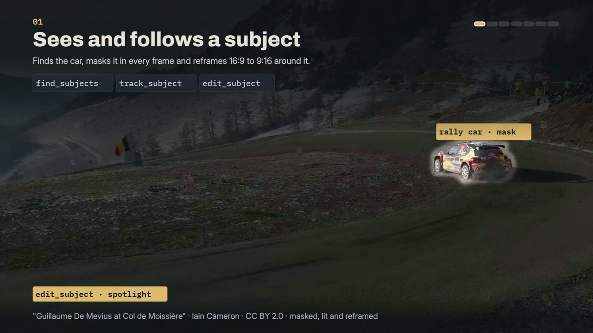
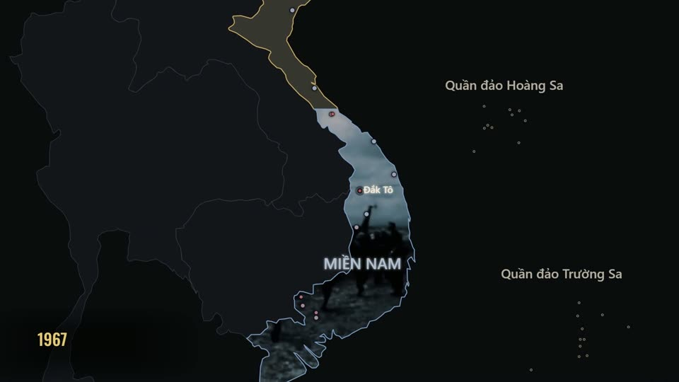

# EditVideo Agent

**Giác quan, đôi tay và kỹ năng bố cục để AI dựng video.** EditVideo Agent là MCP server + CLI cho Claude, Codex hoặc
bất kỳ client MCP nào: *đọc* hình và tiếng, *sửa* timeline có khoá revision hoặc mã nguồn sinh ra, *dựng* bằng Remotion
hay HyperFrames, rồi *kiểm* kết quả bằng phép đo và lặp lại.

Đây không phải phần mềm dựng phim cho người dùng và không có giao diện studio. Mô hình gọi tool quyết định nội dung và
thẩm mỹ; runtime thực thi xác định và trả về bằng chứng (frame, crop, âm thanh, con số). Không có điểm "đẹp" ẩn, không
có cổng duyệt. English: [README.md](README.md).

## Bắt đầu từ đây

- **Dùng thử:** [INSTALL.vi.md](INSTALL.vi.md), rồi `python scripts/demo.py --render`, rồi đọc
  [docs/SPEC.md](docs/SPEC.md) để biết hệ thống gồm những phần nào.
- **Từ một AI host:** không cần nạp schema của 137 tool hay đọc hết tài liệu. `editvideo_bootstrap(task)` trả về vài
  tool và một hướng dẫn mà việc đó cần; `editvideo_discover_tools(query, include_schema=true)` trả schema chính xác khi
  cần; `EDITVIDEO_TOOLSET=compact` chỉ mở 7 tool đầu vào cho host có ngữ cảnh nhỏ.
- **Tìm hướng dẫn:** [docs/README.md](docs/README.md) xếp các hướng dẫn theo việc cần làm. Những tên như "round 6"
  trong vài trang cũ và tên file test ghi lại quá trình xây dựng; không cần đọc chúng.
- **Đóng góp:** [CONTRIBUTING.md](CONTRIBUTING.md).

**v0.8.0 cùng nâng cấp chưa phát hành:** 137 tool MCP · 95 hiệu ứng chạy được (mỗi hiệu ứng có dải xem trước/sau ở cả hai engine) + 7 combo đã
kiểm · 18 loại layer · 17 recipe explainer + 4 recipe tiêu đề · 16 họ font đủ dấu tiếng Việt · 24 bảng màu ·
16 style kit · 7 LUT gốc cùng color graph scene-referred.

## AI nhận được gì

- **Video ngắn và phim:** chọn các đoạn đã xem theo ý và giới hạn thời lượng, dựng dự án nhiều nguồn giữ tiếng gốc;
  lưu trạng thái nhân vật/đạo cụ qua từng shot và tạo gói yêu cầu sinh footage. Riêng TikTok/Reels/Shorts:
  `shortform_audit` đo video đã render theo vùng giao diện của từng nền tảng và các quy tắc có ghi mức bằng chứng;
  phụ đề nảy từng chữ, reframe bám khuôn mặt, dựng talking-head từ các câu chọn sẵn. [Nghiên cứu và cách dùng](docs/SHORTFORM_AND_FILM_RESEARCH.md).
- **Giác quan:** đọc cửa sổ video với frame thật và audio; crop với ánh xạ toạ độ chính xác; phiên âm theo từ; sự kiện
  âm thanh; nhịp/đoạn/điểm nhấn nhạc; đọc hội thoại (người nói, khoảng lặng, từ đệm); hồ sơ sự kiện dựng (cut,
  punch-in, chữ bật); motion audit (đoạn tĩnh, giật, kết đóng băng, viền đen dính trong nguồn); màu và độ đồng nhất giữa
  shot; tracking mặt phẳng/vùng; nghiên cứu video tham khảo.
- **Đôi tay:** patch timeline theo revision; biểu thức dạng dữ liệu (loop, inertia, wiggle, follow-through, **driver**
  liên kết track, **IK hai khớp**); mask, track matte, chroma key, corner pin; cảnh 3D; **color graph scene-referred**
  (log máy quay → grade trong ACEScct → look in phim nhận Cineon nằm dưới output transform → hiển thị, có cửa sổ bám
  track); retime, chống rung, reframe; rút gọn hội thoại có room tone; multicam; chuyển tỉ lệ khung; công cụ GPU tuỳ chọn.
- **Kỹ năng bố cục:** recipe sinh layer chỉnh được — tiêu đề, explainer, time card tài liệu, **evidence_3d** (tư liệu như
  vật thể 3D, đẩy máy tới vùng quan trọng, khung đánh dấu chiếu chính xác), quảng cáo, trailer; thư viện thiết kế đo
  glyph thật (kể cả line-height đo bằng mực để dấu tiếng Việt của hai dòng không chạm nhau).
- **Tự kiểm:** audit timeline, motion audit, cut audit và **agent kiểm duyệt độc lập**
  ([.claude/agents/editvideo-reviewer.md](.claude/agents/editvideo-reviewer.md), tiêu chí [docs/REVIEW_RUBRIC.md](docs/REVIEW_RUBRIC.md)).
- **Học từ thành phẩm thành công:** `learn` (package `learnkit`, không phụ thuộc EditVideo) đăng ký thành phẩm mọi loại
  (video, ảnh, âm thanh, trang web, văn bản) kèm bằng chứng thành công so với mốc, đo chúng và từng phần đã gán vai trò bằng
  cùng giác quan, so sánh nhóm vượt trội với đối chứng, giữ blueprint có bậc bằng chứng, đo sản phẩm mới theo blueprint và ghi
  kết quả thật. Không huấn luyện model. [Hướng dẫn](docs/LEARNKIT.md).
- **Bộ nhớ kỹ năng:** `learning_library` tìm lại video tham chiếu và bài học bằng tiếng Việt/Anh, trả đúng đoạn cần xem;
  `remember_lesson` lưu nguyên tắc, lúc nên dùng/tránh, các bước, ví dụ thao tác và video minh hoạ để phiên sau áp dụng.
  Đây là bộ nhớ ngoài của AI, không huấn luyện trọng số hay tự chạy ví dụ. [Quy trình](docs/LEARNING_FROM_REFERENCES.md).

**Tiết kiệm token:** JSON gọn, schema rút gọn, catalog trả từng dòng cho tới khi hỏi đúng id, handle thay vì đổ dữ liệu,
gói ảnh chỉ kèm evidence id. `EDITVIDEO_TOOLSET=compact` chỉ mở 7 tool đầu vào.

## Phim demo

[](https://github.com/lamtung0487-droid/editvideo-agent/releases/download/demo-reel-v2/editvideo-reel-1080p.mp4)

**[EditVideo Agent trong 89 giây](https://github.com/lamtung0487-droid/editvideo-agent/releases/download/demo-reel-v2/editvideo-reel-1080p.mp4)** (1080p, 51 MB, tải từ trang Release; bản
[xem nhanh 720p](docs/demo/editvideo-reel-720p.mp4) nằm trong repo): các công cụ làm việc trên toàn khung hình.
Hệ thống tìm và bám theo một vật thể, cắt theo nhạc, giải thích bằng 3D và đồ họa chuyển động, render 3D, chỉnh màu,
dựng lịch sử từ tư liệu lưu trữ và tự kiểm tra sản phẩm. Mỗi chương ghi tên tool MCP đã làm ra nó; footage là tư liệu
thật, có ghi nguồn. Chi tiết từng chương: [docs/demo](docs/demo/README.md).

Ba phim tư liệu ngắn do hệ thống tự dựng từ đầu đến cuối bằng tư liệu công cộng (bản xem trước 720p):

| [](docs/demo/leo-thang-720p.mp4) | [](docs/demo/lan-rong-720p.mp4) | [](docs/demo/vinh-bac-bo-720p.mp4) |
|---|---|---|
| **Leo thang 1964-1968**: `archive_montage`, nhịp cắt dồn dần tới cú đánh | **Lan rộng 1965-1968**: `map_matte`, footage nằm trong vùng đất nơi nó được quay | **Vịnh Bắc Bộ 1964**: `dossier`, tài liệu gốc quay cận cảnh |

## Cài đặt

Cần Python 3.11+, Node.js 22+, FFmpeg/FFprobe trên `PATH`. Windows đã kiểm thử; `setup.sh` cho Linux/macOS (ít kiểm hơn).
Hướng dẫn đầy đủ (công cụ nền, gói tùy chọn, kết nối AI, xử lý sự cố): [INSTALL.vi.md](INSTALL.vi.md). Đặc tả hệ
thống: [docs/SPEC.md](docs/SPEC.md).

```powershell
./setup.ps1            # lõi: venv, engine (npm ci), tự viết .mcp.json cho thư mục này
./setup.ps1 -Vision    # + SAM 2 / depth / LaMa (CUDA)
./setup.ps1 -Temporal  # + ProPainter và LTX local
./setup.ps1 -Voice     # + thuyết minh tiếng Việt offline: Piper (GPL-3.0, chạy tiến trình riêng), giọng vi_VN và Whisper small căn mốc từ (~580 MB)
```

Claude Code: mở thư mục, `.mcp.json` đăng ký server, skill ở `.claude/skills/editvideo-agent`. Codex: skill ở
`.agents/skills/editvideo-agent`. Mỗi phiên bắt đầu bằng `editvideo_bootstrap(task)` rồi `editvideo_discover_tools`.

Kiểm thử: `python -m pip install -r requirements-dev.txt` rồi `python -m pytest -q`. Khoảng 600 test, chạy khoảng 15
phút trên CPU. Test của gói tùy chọn tự bỏ qua khi chưa cài gói đó, và bộ test dùng kho dữ liệu tạm riêng.

## Giấy phép

EditVideo Agent phát hành theo [Apache License 2.0](LICENSE) ([NOTICE](NOTICE)). Engine, font, model, dữ liệu và media
mà hệ thống dùng giữ giấy phép riêng của chúng: xem [THIRD_PARTY_NOTICES.md](THIRD_PARTY_NOTICES.md).
- Remotion miễn phí cho cá nhân và công ty nhỏ; công ty lớn vì lợi nhuận cần giấy phép công ty. HyperFrames
  (Apache-2.0) là engine mở.
- ProPainter chỉ dùng phi thương mại.
- Piper (GPL-3.0) chạy như một tiến trình riêng.

Đóng góp: [CONTRIBUTING.md](CONTRIBUTING.md) · Quy tắc ứng xử: [CODE_OF_CONDUCT.md](CODE_OF_CONDUCT.md) · Báo lỗ hổng:
[SECURITY.md](SECURITY.md).
