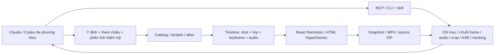

# Nghiên cứu và nâng cấp EditVideo Agent — 12/10/2026

Mục tiêu: cung cấp khả năng cho Claude/Codex đọc, phân tích và dựng video bằng code. Ưu tiên video kiến thức/thuyết minh, đồng thời cho phép mở video có sẵn và tinh chỉnh toàn bộ các lớp hình/âm thanh. Sản phẩm chính là MCP, CLI, runtime và skill; không xây thêm studio, hội đồng kiểm duyệt hay cổng chấm điểm.

## Những điểm yếu có bằng chứng

Không có một kết luận chung rằng mọi mô hình hiện tại đều kém. Các nguồn dưới đây chỉ ra từng vấn đề và loại tác vụ; kết quả của mô hình trong một benchmark không được suy rộng sang mọi bản phát hành mới.

| Vấn đề | Nguồn gốc | Hệ quả thiết kế |
|---|---|---|
| Tổng hợp nhiều khoảnh khắc, hiểu diễn biến thời gian và giữ lập luận nhất quán vẫn là các tác vụ riêng, khó hơn mô tả ảnh đơn | [Video-MME-v2, 04/2026](https://arxiv.org/abs/2604.05015) tổ chức các nhóm hiểu thời gian và reasoning liên quan nhiều điểm của video | Chỉ mục cảnh → chọn đoạn → chuỗi frame dày → nghe audio; luôn khai khoảng lấy mẫu |
| Nhận biết nội dung chưa đồng nghĩa biết chọn tư liệu, xác định mốc và dựng câu chuyện có kỹ thuật điện ảnh | [VEBench, 05/2026](https://arxiv.org/abs/2605.03276) nghiên cứu nhận diện kỹ thuật dựng và mô phỏng thao tác biên tập | Công cụ phải nối quan sát với thao tác thật: shot, source offset, lớp, keyframe, transition, audio và source code |
| Hệ thống chuyên một miền hoặc đoạn ngắn khó bao quát nhiều kiểu dựng và câu chuyện dài | [VideoAgent, 06/2026](https://arxiv.org/abs/2606.23327), một preprint, mô tả bài toán kết hợp hiểu video với nhiều thao tác dựng | Tách perception, catalog, timeline và renderer; dùng skill để điều hướng theo mục đích. Không sao chép kiến trúc nhiều agent hay coi số liệu tác giả là bằng chứng của hệ thống này |
| Đẹp bề mặt chưa đảm bảo nội dung đúng, vật lý hợp lý hoặc bố cục đáp ứng ý định | [VBench2.0, 03/2025](https://arxiv.org/abs/2503.21755) phân biệt fidelity bên trong với chất lượng thị giác bề mặt | Phân tích thẩm mỹ phải xét ý nghĩa, hình–lời, phân cấp và tính nhất quán; không dùng một điểm “đẹp” để quyết định xuất video |
| Sinh clip dài hoặc yêu cầu nhiều chuyển động cùng lúc khó điều khiển chi tiết | [Sora 2 Prompting Guide](https://developers.openai.com/cookbook/examples/sora/sora2_prompting_guide) hướng dẫn chia hành động theo beat, mô tả camera/ánh sáng rõ và ưu tiên đơn vị shot ngắn khi cần độ bám yêu cầu | Video dài nên dựng từ shot có ý định rõ; dùng lớp/code để tinh chỉnh chữ và chuyển động chính xác. Không âm thầm gọi API sinh video trả phí |
| Chữ trong cảnh chuyển động đòi hỏi vừa đúng ký tự, vừa nhất quán thời gian và giữ cảnh xung quanh | [ViTeX-Bench, 09/2026](https://arxiv.org/abs/2609.40356), preprint về scene-text editing | Tách overlay chữ có thể sửa chính xác khỏi xóa/đổi chữ nằm trong footage cần tracking, mask và inpainting chuyên dụng |
| Claude nhìn ảnh có giới hạn ở chữ nhỏ, vị trí và ảnh bị resize; GIF không cung cấp toàn bộ chuyển động | [Anthropic Vision](https://platform.claude.com/docs/en/build-with-claude/vision) và [Vision coordinates](https://platform.claude.com/docs/en/build-with-claude/vision-coordinates) | Trả frame tĩnh theo thời gian, crop nguồn, kích thước ảnh thực và ánh xạ tọa độ; không gọi GIF là phân tích toàn video |

## Vấn đề hiệu ứng: thiếu khả năng tiếp cận hơn là thiếu nền tảng

[Remotion](https://www.remotion.dev/docs/transitions/) đã có hệ chuyển cảnh và các module đồ họa; [Hyperframes](https://github.com/heygen-com/hyperframes) có hướng dẫn animation, transition và blueprint. Wrapper ban đầu của EditVideo chỉ đưa ra bốn motion và ba kiểu overlay. Agent phải biết trước kỹ thuật rồi tự viết gần như mọi thứ; đây là khoảng trống của hệ thống này.

Nâng cấp hiện tại đưa **69 hiệu ứng có thực thi**, không chỉ một danh sách tên, vào runtime dùng chung. Mỗi hiệu ứng có: family, engine, target hợp lệ, mục đích dùng, tham số có đơn vị/range/default, ví dụ, lưu ý về nội dung và frame mẫu từ video atlas đã render. Tám recipe nối ý định với cách phối hợp: callout kiến thức, inset tư liệu, số đếm, so sánh, quy trình, đường biểu đồ, đổi chủ đề và hình tham chiếu chậm.

Các family: entrance/exit, camera/motion, reveal/text, grade/light, mask/texture/frame, data. Hiệu ứng text chỉ áp dụng lớp text; `progress` chỉ dùng infographic. Tham số sai hoặc tên không có được báo lỗi trước render. Không giả định các transition/package thương mại upstream đã được tích hợp; runtime portable trong repo tự thực thi bộ được công bố.

## Kiến trúc đã triển khai

| Năng lực | Công cụ/thực thi hiện tại | Phạm vi thực |
|---|---|---|
| Đọc footage dài | `index_video` | Tối đa một giờ; candidate cuts bằng FFmpeg `scdet`, các đoạn và mốc đề xuất; phân trang |
| Đọc chuyển động | `inspect_window`, `extract_clip` | 2–12 frame theo thứ tự trong đoạn ≤30s, audio; clip ≤60s để xem liên tục |
| Đọc chi tiết | `crop_detail` | Crop từ nguồn, không phóng đại thumbnail; trả source/display dimensions và phép đổi tọa độ |
| Thẩm mỹ | `aesthetic_packet`, prompt `video_director`, resource `director-guide`, skill references | Pixel/audio + màu/luminance/chênh pixel lấy mẫu + hướng dẫn reasoning; Claude đưa ra nhận xét và sửa dựa trên bằng chứng |
| Lời nói | `transcribe` | Whisper CPU int8 local, mặc định small, từ/timestamp ước lượng, đoạn lời và cue/SRT ngắn; gợi ý thuật ngữ tùy chọn |
| Chuyển động vùng hình | `track_region` | Lucas–Kanade sparse flow, kiểm tra forward/backward, dừng khi mất dấu; xuất vùng và x/y keyframe |
| Dựng đa tầng | `upsert_layer`, `delete_layer` | Chữ, ảnh, video, shape, counter, bar/line chart, flow, particles; vị trí/kích thước/z/opacity/blend/rotation |
| Animation | `effects`, `keyframes` | 69 effects, x/y/scale/rotate/opacity/blur; frame-based, seed xác định, seek ngược được |
| Chuyển cảnh | `shot.transition` | Dissolve, bốn hướng wipe, iris, blur-in, zoom-in; giữ nguyên thời lượng audio/timeline |
| Footage | `update_shot`, media layers | Source trim, contain/cover, focus và playback rate |
| Audio | `upsert_audio`, `delete_audio` | Các đoạn nguồn/audio/SFX ở mốc frame, trim/rate/gain/fade/duck rồi normalize mix |
| Video có sẵn | `project_from_video` | Giữ hình và audio nguồn hoặc silence; không buộc viết script/TTS, sau đó split và chỉnh |
| Code tùy biến | `read_code`, `write_code`, `export_code` | Code là cửa mở rộng. Runtime v2 làm mới dữ liệu trong snapshot mà không viết đè entry/runtime tùy chỉnh |

Thẩm mỹ ở đây là **năng lực quan sát và suy luận của agent được hỗ trợ bằng bằng chứng và công cụ**, không phải một model “gu thẩm mỹ” độc lập vừa được huấn luyện. Claude/Codex phải có khả năng nhận ảnh; âm thanh còn phụ thuộc client/model. Với client không hỗ trợ nghe WAV, ASR và artifact âm thanh hỗ trợ xử lý nhưng không thay thế việc nghe.

Các số luminance/pixel change/energy chỉ là thuộc tính nguồn để định vị vấn đề, không là bảng chấm điểm hay cổng nghiệm thu. Bộ dựng vẫn kiểm tra nguồn, thời lượng và file decode được vì file hỏng không sử dụng được.

## Cách agent ra quyết định hình ảnh

1. Xác định người xem cần hiểu gì, hình nào giải thích được điều đó và hình nào chỉ trang trí.
2. Đọc tham chiếu, xác định palette, hierarchy, mật độ thông tin, phong cách chuyển động; ghi `set_design`.
3. Index footage, kiểm tra đoạn liên quan bằng frame/audio, crop khi chữ hoặc chủ thể quá nhỏ. Không suy diễn cảnh chưa được quan sát.
4. Nhận xét cụ thể theo timestamp/region: vấn đề, ảnh hưởng đến ý nghĩa/khả năng đọc, thao tác sẽ sửa. Nêu phần chưa chắc.
5. Tra catalog theo mục đích, xem preview và dùng tham số đúng; một beat có một chuyển động chính. Không chồng hiệu ứng chỉ để làm video “nhiều hiệu ứng”.
6. Snapshot lúc vào/đang chuyển/đã ổn định và những mốc đổi cảnh. Render rồi đọc lại đầu ra thực; sửa vấn đề nhìn/nghe được.

## Kiểm tra và giới hạn

Bằng chứng chạy nằm trong [VERIFICATION.md](VERIFICATION.md), `outputs/effect-atlas.json` và `outputs/advanced-verification.json`. Atlas hiện được mở rộng từ50 lên69 effect, render thật trên cả hai engine, không phải ảnh mô phỏng giao diện.

- `scdet` tìm thay đổi pixel, không hiểu ranh giới câu chuyện. Thuộc tính hình mẫu 1Hz có thể bỏ qua hành động nhanh. Chỉ mục là bản đồ để gọi quan sát sâu, không bản phân tích nội dung tự động.
- Tracker vùng nhẹ vẫn theo texture theo [OpenCV](https://docs.opencv.org/4.x/d4/dee/tutorial_optical_flow.html). Đã bổ sung SAM2 video masks/corrections, crop bám, alpha và LaMa inpainting chạy GPU thật. Đã bổ sung ProPainter temporal neural inpainting, ghép cửa sổ có overlap và chặn truyền qua cảnh cắt; chưa có semantic re-identification được xác minh. [Chi tiết backend](SUBJECTS_AND_GENERATION.md).
- ASR small cải thiện nhiều thuật ngữ trong mẫu tiếng Việt so với base, nhưng vẫn sai một số từ. Không dùng transcript làm sự thật hay tự sửa lời gốc. Word time không phải forced alignment. Thực thi theo [faster-whisper](https://github.com/SYSTRAN/faster-whisper).
- Transition portable dùng **frame cuối của shot trước được giữ tĩnh**, chồng shot mới trong thời gian transition. Chưa phải transition có source handles tiếp tục chuyển động hai phía; thời lượng narration không bị rút ngắn.
- Output hiện 30fps, 48kHz, ba profile Full HD. Có nativecolor media pipeline/SDR authoring proxy và3Dprimitives/lights/materials/framecamera; chưa timeline FPS tùy ý, fullHDRbrowsercompositor, calibratedscene reconstruction hay renderfarm. Xem COLOR_DEPTH_3D.md và MODEL_INTEGRATION.md.
- Shared timeline chạy ở cả hai engine; code custom React và HTML vẫn là hai source độc lập, không tự dịch qua lại. Source v1 cũ cần export v2 một lần và chủ động giữ custom code trước overwrite.
- Đã tích hợp local_ltx CUDA text/image-to-video để tạo shot từ prompt trên máy; adapter ComfyUI/Runway đã kiểm HTTP nhưng chưa live API. Text-to-video local đã chạy thật: 121 frame/768×448, ghép vào bản dựng Việt Full HD 52,83s; manifest ở outputs/local-generation-verification.json. Image-to-video đã chạy thật với ảnh tham chiếu và ảnh neo cuối; thêm cache prompt/posterior, preset và phiên bản tinh chỉnh có lineage. Xem [nâng cấp image-to-video/đọc chuyển động](IMAGE_VIDEO_AND_TEMPORAL_READING.md). Chỉ chạy khi agent submit provider cụ thể; không tự gọi API trả phí. Chưa có embedding semantic retrieval chạy nền. API keys không bị chuyển sang process render.

Các giới hạn được khai trong tool/skill để agent chọn đúng thao tác. Không có bước phê duyệt mới được thêm vào.

## Đọc chuyển động và tinh chỉnh ảnh tham chiếu

Đã bổ sung dense flow hai chiều, camera affine candidate, residual motion-compensated, trace/FFT ROI và temporal RGB lens. Những công cụ này trả pixel/timestamp/đơn vị/giới hạn để AI làm creative direction; không phải identity/aesthetic scorer. Prompt/posterior cache giữ tính toán encoder không đổi, chưa dùng approximate attention caching. Các kỹ thuật có tiền lệ được dẫn nguồn trong [guide](IMAGE_VIDEO_AND_TEMPORAL_READING.md); không tuyên bố độc quyền hay đã tích hợp mọi kỹ thuật trên thị trường.

## Dựng chuyên nghiệp từ TikTok tới YouTube

Bổ sung [playbook](PROFESSIONAL_VIDEO_PLAYBOOK.md): ma trận story/promise/payoff, footage, continuity, composition, captions, motion, màu, âm thanh và adaptation; nguồn TikTok/YouTube/Adobe/Blackmagic có phạm vi rõ. 16 recipe biên dịch thành edit thật, 12 effects mới, caption nhiều trang và tracked callout chạy cùng dữ liệu/frame ở hai engine. Audio event reader, procedural sound design và master/duck settings giúp Claude đặt âm có mục đích. Hướng dẫn không chấm beauty/virality và không yêu cầu phê duyệt.
